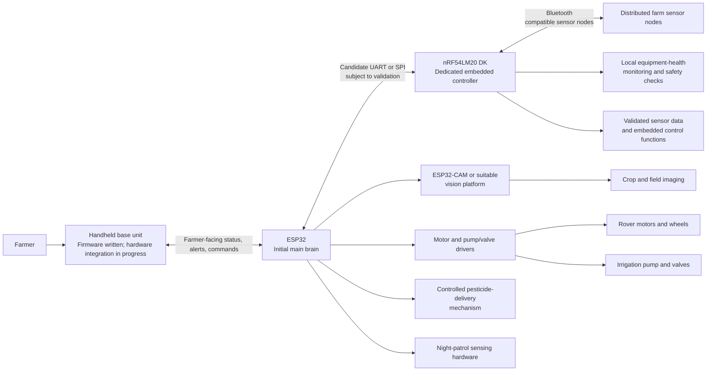

# VerdantIQ

**An intelligent agricultural guardian rover for crop disease detection, smart pesticide application, animal intrusion prevention, precision irrigation, environmental monitoring, and predictive maintenance.**

## Project overview

VerdantIQ is a planned multifunctional agricultural rover and farmer-interface system intended to help protect crops, monitor field conditions, reduce avoidable resource waste, and identify developing problems before they become serious losses. The design combines a mobile rover, distributed farm sensors, a farmer's handheld base unit, and dedicated embedded control using the Nordic **nRF54LM20 DK**.

The project is being prepared for Nordic Semiconductor's **Sustain the System** hardware competition. Its engineering focus is not only automation: VerdantIQ is intended to collect meaningful real-world data, detect changes, alert the farmer, recommend practical next steps, and support more efficient use of water, chemicals, energy, and equipment.

> **Status note:** The farmer's handheld base-unit firmware has been written, and its hardware setup and integration are in progress. The rover architecture, preliminary hardware design, and BOM are being developed. Planned capabilities in this README are not presented as completed or validated functions.

## Planned capabilities

1. **Crop disease detection** using camera-based imaging and computer vision.
2. **Smart pesticide application** based on detected crop conditions and appropriate application rules, with safety controls and human oversight.
3. **Night patrols** to detect potential animal intrusion and alert the farmer; detection performance remains to be validated.
4. **Environmental monitoring** using rover-mounted and distributed sensor nodes.
5. **Precision irrigation** using soil-moisture measurements and other relevant field data.
6. **Predictive maintenance** through equipment-health monitoring and abnormal-pattern detection.
7. **Farmer handheld base unit** for sensor readings, rover status, alerts, and control options.

## Current development status

### Existing progress

- The farmer's handheld base-unit firmware has been written.
- Base-unit hardware setup and integration are in progress.
- The broader multifunctional agricultural rover is under development.
- The initial rover architecture and subsystem responsibilities are being planned.
- A preliminary hardware design and editable BOM are being prepared.

### Not yet established in this repository

- The base-unit source code is not included at this stage.
- No claim is made that the base-unit firmware has been fully tested.
- No claim is made that the base-unit hardware is completely assembled.
- No claim is made that the rover is operational, that field trials are complete, or that any sustainability benefit has been measured.
- Final hardware selections, quantities, communication protocols, and complete procurement details remain open decisions.

See [current status](docs/current_status.md) for a concise, updateable record.

## Planned system architecture

This is a **planned architecture**, not a representation of completed integration.

### Subsystem responsibilities

- **ESP32 — initial main brain:** coordinates high-level rover decisions, mission execution, and subsystem coordination. It may exchange commands and status with the Nordic controller over UART or SPI after interface and compatibility validation.
- **Nordic nRF54LM20 DK — dedicated embedded controller:** acquires and validates selected sensors, performs appropriate sensor fusion, handles real-time embedded-control functions, monitors equipment health locally, runs threshold-based anomaly and safety checks, communicates with compatible distributed sensor nodes over Bluetooth, and evaluates edge-AI approaches that fit the board's actual hardware and SDK capabilities.
- **Vision subsystem:** an ESP32-CAM or another suitable platform captures crop and field images and performs vision processing within its real capabilities. Demanding crop-disease models are not assumed to run on the Nordic board.
- **Farmer handheld base unit:** presents rover status and sensor readings, displays alerts and field information, accepts farmer commands, and provides the farmer-facing interface. Its exact existing hardware and wireless protocol are intentionally not invented here.
- **Distributed sensor nodes:** collect soil and environmental measurements from different farm locations and communicate with the rover using a suitable wireless approach to be selected and validated.
- **Actuators and power hardware:** may include motors, motor drivers, irrigation pumps and valves, a controlled pesticide-delivery mechanism, night-patrol sensing hardware, battery storage, and power-management circuitry. External drivers and safe actuator states are required.

## Why the Nordic nRF54LM20 DK matters

The Nordic board has an engineering purpose beyond adding another microcontroller. It is intended to provide a dedicated, low-power embedded-control and monitoring layer that can continue validating measurements, checking equipment conditions, and enforcing safety behavior while the ESP32 coordinates higher-level missions.

Its planned role supports the competition objectives in several ways:

- **Meaningful Bluetooth data:** compatible distributed sensor nodes can share soil and environmental measurements so that decisions are based on field conditions rather than a single local reading.
- **Local monitoring:** motor current, pump behavior, temperature, water flow, battery conditions, and related signals can reveal abnormal operation such as a stalled motor, dry-running pump, blocked line, overheating, unexpected flow, or degrading battery behavior.
- **Actionable alerts:** the Nordic layer can report abnormal conditions to the ESP32 and farmer base unit, allowing inspection, shutdown, reduced operation, or another defined response.
- **Efficient embedded control:** measurement validation, watchdogs, timeouts, and safe-state handling can be placed close to the hardware that needs protection.
- **Suitable edge intelligence:** compact models or feature-based classifiers may be evaluated on the Nordic platform only after confirming peripheral support, SDK compatibility, memory use, timing, and actual model performance. It is not assumed to run demanding vision workloads.

Basic threshold or trend-based anomaly detection is not automatically predictive maintenance. Genuine failure prediction requires recorded operating data, meaningful features, suitable historical examples, and validation against real outcomes. VerdantIQ will treat predictive maintenance as a development goal until those requirements are met.

## Sustainability objectives

VerdantIQ is intended to support the **Sustain the System** objective by:

- Detecting developing equipment and field problems before avoidable damage or waste occurs.
- Using soil and environmental measurements to support more targeted irrigation decisions.
- Monitoring water flow and pump behavior to identify leakage, blockage, or inefficient operation.
- Supporting controlled pesticide application based on evidence and farmer-approved rules rather than indiscriminate application.
- Extending useful equipment life through condition monitoring and timely inspection.
- Giving the farmer understandable alerts and recommended next steps instead of presenting raw data only.
- Recording data needed to measure resource use, intervention frequency, false alarms, and equipment outcomes.

These are intended benefits, not measured results. The repository will be updated as tests produce evidence.

## Development roadmap

1. Define the preliminary architecture and BOM.
2. Set up and verify the Nordic development environment.
3. Validate sensor acquisition and measurements.
4. Establish Bluetooth communication with a compatible sensor node.
5. Implement equipment-health monitoring using thresholds and trends.
6. Deliver farmer alerts and actionable recommendations.
7. Integrate Nordic, ESP32, and the farmer's base unit.
8. Experiment with smart irrigation and resource monitoring.
9. Develop crop imaging, disease-detection integration, pesticide application, and night patrols.
10. Perform system testing, field validation, and sustainability measurements.
11. Evaluate a future Raspberry Pi migration as an optional main-computing upgrade.

The detailed, criteria-based plan is in the [development roadmap](docs/development_roadmap.md).

## Repository guide

- [Preliminary editable BOM](hardware/BOM.md)
- [Planned system architecture](docs/system_architecture.md)
- [Current development status](docs/current_status.md)
- [Development roadmap](docs/development_roadmap.md)
- [Firmware organization and integration notes](firmware/README.md)

The `images/` directory is reserved for verified project images and diagrams. It is intentionally empty until an actual image is added.

## Future computing upgrade

A Raspberry Pi may eventually replace the ESP32 as the main brain if the project's processing, storage, or vision requirements justify it. This is a planned future evaluation, not a completed migration. The Nordic board is expected to remain the dedicated embedded controller unless later testing shows a better validated architecture.

## Engineering and safety principles

- Verify peripheral support, pins, interfaces, SDK compatibility, and memory requirements before implementation claims are made.
- Use external drivers for motors, pumps, and valves; do not drive power loads directly from MCU pins.
- Include communication timeouts, watchdogs, safe actuator states, and a practical manual override.
- Treat pesticide delivery as a controlled agricultural operation requiring application limits, interlocks, calibration, and appropriate human and environmental safety precautions.
- Treat night-patrol sensing as an intended capability until detection performance is tested.
- Keep demanding computer vision on a suitable vision or main-computing platform.
- Record operating data before making predictive-maintenance claims.

## Contribution and documentation status

This repository currently prioritizes architecture, traceability, and honest status reporting while hardware integration proceeds. Hardware part numbers, quantities, interfaces, test evidence, and measured sustainability outcomes should be added only when verified.
