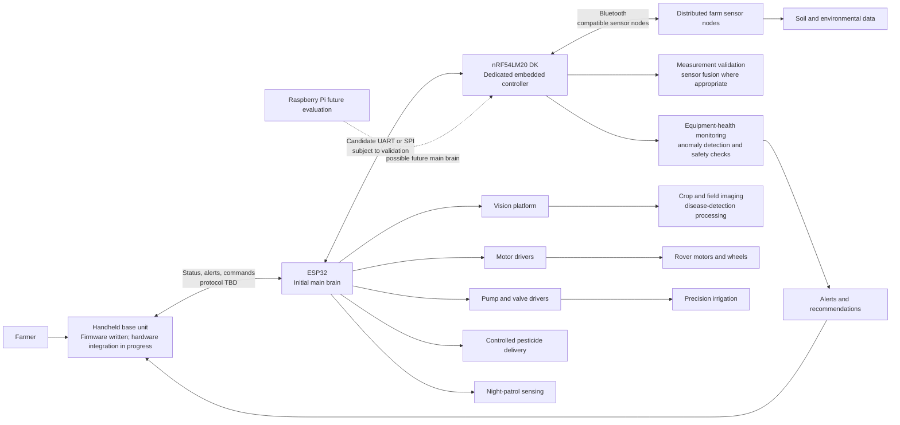

# Planned System Architecture

> **Architecture status:** This document describes the current planned architecture. It is not evidence of completed hardware integration or a running rover.

## 1. Overall system overview

VerdantIQ is planned as a layered agricultural monitoring and mobile-response system:

- A farmer's handheld base unit provides the human interface for status, sensor readings, alerts, and commands. Its firmware has been written; hardware setup and integration are in progress. Its exact hardware and wireless protocol are not defined here without source evidence.
- The ESP32 is the initial main brain for high-level mission execution and subsystem coordination.
- The Nordic nRF54LM20 DK is a dedicated embedded controller for validated sensor acquisition, embedded control, Bluetooth-connected farm sensing, equipment-health monitoring, local anomaly detection, and safety behavior.
- A suitable vision platform, such as an ESP32-CAM or another platform selected after evaluation, handles crop and field image capture and processing within its capabilities.
- Distributed sensor nodes provide measurements from different farm locations.
- External drivers control motors, pumps, valves, and other power loads.

The seven planned capabilities remain part of one system: crop disease detection, smart pesticide application, night patrols for potential animal intrusion, environmental monitoring, precision irrigation, predictive-maintenance development, and farmer-facing operation through the base unit.

## 2. Planned architecture diagram

The diagram is intentionally a proposal. Interfaces, pin assignments, protocols, sensor placement, and final computing allocation require validation.

## 3. ESP32 responsibilities

The ESP32 initially coordinates:

- High-level rover decisions and mission sequencing.
- Subsystem coordination and command routing.
- Motor and fluid-control requests through appropriate external drivers.
- Coordination with the vision subsystem.
- Reporting status and events to the farmer base unit through the eventual validated interface.
- Coordination with the Nordic controller over candidate UART or SPI.

The ESP32 should not be treated as a direct power driver. Motor, pump, and valve loads require suitable driver and protection circuits.

## 4. Nordic nRF54LM20 DK responsibilities

The Nordic board is deliberately assigned functions that benefit from a dedicated embedded controller:

1. **Sensor acquisition and validation:** sample selected sensors, reject invalid or implausible values, apply calibration as validated, and provide timestamped data.
2. **Embedded control:** perform time-sensitive local functions and control-related checks without depending on every high-level mission decision.
3. **Bluetooth-connected sensing:** exchange measurements and health information with compatible distributed farm sensor nodes. Protocol, security, node power model, and field behavior remain to be validated.
4. **Equipment-health monitoring:** combine current, temperature, flow, battery, and operating-state information where available to identify abnormal conditions.
5. **Local anomaly detection:** begin with explicit thresholds and trends; evaluate compact edge-intelligence methods only after hardware and SDK feasibility is demonstrated.
6. **Safety behavior:** implement communication timeouts, watchdogs, sanity checks, and defined safe states for supported functions.

The Nordic controller is not assumed to run demanding crop-disease computer-vision models. Those workloads belong on a suitable vision or main-computing platform after evaluation.

## 5. Farmer handheld base unit

The base unit is already under active development:

- Its firmware has been written.
- Hardware setup and integration are in progress.
- The repository does not currently include that firmware source code.
- Testing status, exact components, and wireless protocol are not claimed here.

Its intended role is to present rover status and sensor readings, display alerts and field information, allow farmer commands, and provide human oversight for operations such as irrigation, patrol response, and controlled pesticide delivery.

## 6. Vision subsystem

An ESP32-CAM or another suitable vision platform is planned for crop and field image capture. The final platform must be selected based on image quality, lighting, storage, processing, connectivity, and model requirements. Crop-disease detection is a planned function and requires image-data, model, and field-validation work.

## 7. Distributed sensor nodes and Bluetooth

Sensor nodes may be placed at different farm locations to collect soil moisture, temperature, humidity, and other relevant field measurements. The Nordic controller is intended to communicate with compatible nodes using Bluetooth technology, subject to final protocol, power, enclosure, and field-range validation.

No fixed connection limit or guaranteed wireless range is assumed. The design must address pairing or provisioning, identity, lost-node handling, stale data, timestamps, retries, security, and battery behavior.

## 8. Motor and irrigation control interfaces

The ESP32 or another validated coordinator will issue commands to external motor and pump/valve drivers. The design should include:

- Current and voltage compatibility checks.
- Flyback and transient protection where applicable.
- Fusing and power isolation appropriate to the loads.
- Communication timeouts and watchdog behavior.
- Safe actuator states on boot, fault, or lost communication.
- Manual override and emergency-stop behavior.
- Water-flow feedback so commanded irrigation can be compared with actual flow.

Pesticide delivery requires additional application controls, containment, calibration, interlocks, and appropriate safety procedures. It must not be treated as an unbounded autonomous spraying feature.

## 9. ESP32-to-Nordic communication

UART or SPI are candidate interfaces between the ESP32 and Nordic controller. The final choice depends on pin availability, throughput, electrical compatibility, firmware complexity, cable length, fault behavior, and validation on the selected boards.

A proposed message design should eventually define:

- Framing and versioning.
- Message IDs and payload limits.
- Timestamps and sequence numbers.
- Health/status messages.
- Command acknowledgements and timeouts.
- Fault reporting and recovery behavior.
- Safe behavior when either controller resets or communication stops.

These are design requirements, not completed implementation claims.

## 10. Future Raspberry Pi migration

A Raspberry Pi may eventually replace the ESP32 as the main brain if additional processing, storage, connectivity, or vision integration requires it. This is a future evaluation. The Nordic board is intended to remain the dedicated embedded controller unless measured testing supports a different architecture.

## 11. Sustainability and equipment-health monitoring

The architecture supports the competition objective by collecting real operating data and turning it into actionable decisions. Examples include:

- Rising motor current with reduced motion may indicate a jam, overload, or mechanical resistance.
- Pump current, temperature, and flow together may reveal dry running, blockage, leakage, or degradation.
- Battery voltage and load behavior may identify abnormal power conditions.
- Temperature trends may indicate overheating before a shutdown.
- Soil moisture and water-flow records can support irrigation review and resource measurement.

Thresholds and trend alarms are useful first steps, but they are not genuine predictive maintenance by themselves. Failure prediction requires historical operating data, suitable labels or outcomes, validated features/models, and measurement of false positives and missed failures.

## 12. Unresolved technical decisions

The following require engineering validation:

- Final ESP32, vision platform, sensors, drivers, motors, pumps, valves, battery, and enclosure selections.
- Exact base-unit hardware and wireless protocol.
- Nordic SDK/toolchain configuration and supported peripheral mapping.
- ESP32-to-Nordic UART or SPI choice and message protocol.
- Distributed-node Bluetooth topology, security, provisioning, range, and power strategy.
- Sensor calibration, placement, sampling rates, and data quality rules.
- Data logging, storage, timestamps, and analysis workflow.
- Edge-AI model scope, memory/timing feasibility, and validation dataset.
- Actuator safety, emergency stop, manual override, pesticide controls, and field operating procedures.
- Test methods for animal intrusion detection, irrigation outcomes, disease detection, and sustainability measurements.
